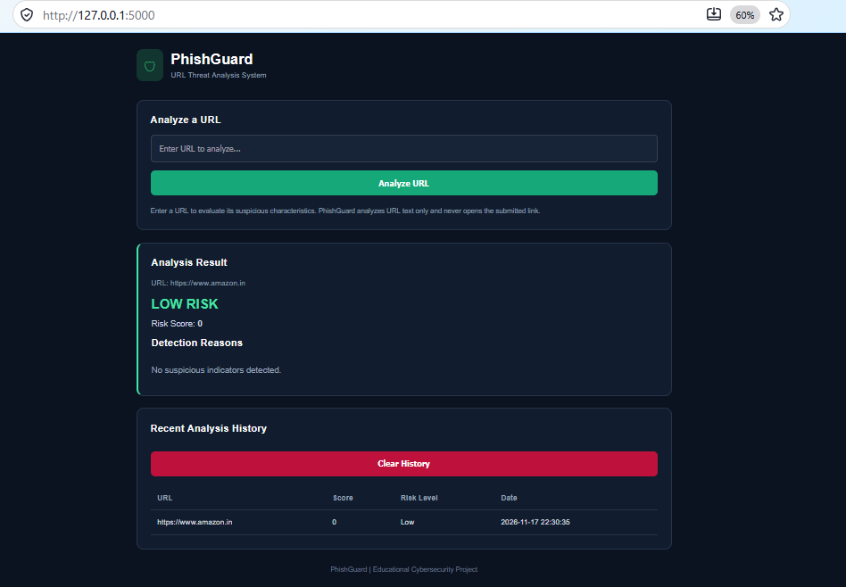
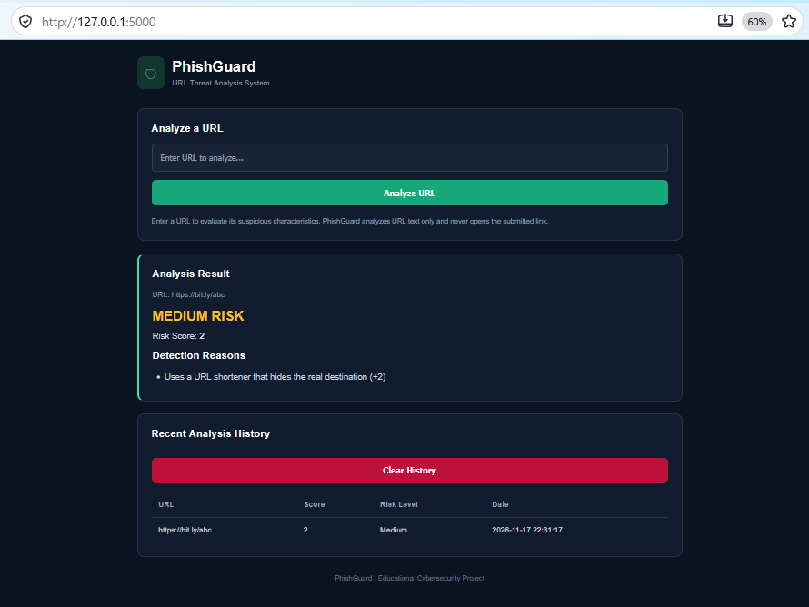
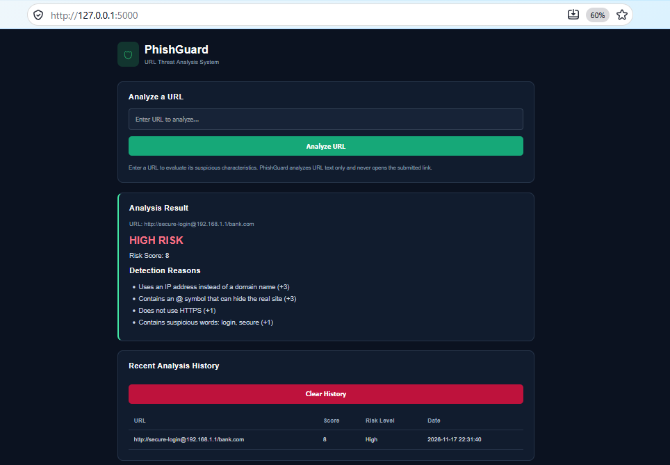

# PhishGuard

PhishGuard is a rule-based phishing link checker. You give it a link, and it
returns a risk level (**Low**, **Medium** or **High**), a score, and a plain-language
list of the warning signs it found.

**Links are analysed as text only. PhishGuard never opens or visits a link.**

It comes in two forms: a command-line tool (`run_cli.py`) and a small web page
(`app.py`, built with Flask) that also keeps a history of checked links.

## How it works

`checks.py` contains 11 independent checks that each read only the text of the link.
`scoring.py` adds a weighted number of points for each warning sign and turns the
total into a risk level.

| # | Check | What it looks for | Points |
|---|-------|-------------------|--------|
| 1 | Long URL | Link longer than 75 characters | 1 |
| 2 | IP address | Raw IP address instead of a domain name | 3 |
| 3 | `@` symbol | `@` in the host part (browsers ignore what comes before it) | 3 |
| 4 | Many subdomains | More than 3 dots in the host | 2 |
| 5 | No HTTPS | Link does not start with `https://` | 1 |
| 6 | Suspicious words | login, verify, update, secure, account, signin, confirm, banking | 1 |
| 7 | Brand look-alike | Imitates a known brand (e.g. `paypa1.com`, `rnicrosoft.com`) without being its real domain | 3 |
| 8 | Hyphens or digits | More than 2 hyphens or more than 3 digits in the domain | 1 |
| 9 | URL shortener | `bit.ly`, `tinyurl.com` and similar | 2 |
| 10 | Free hosting | `netlify.app`, `github.io`, `pages.dev` and similar | 2 |
| 11 | Risky ending | Cheap domain endings often used for throwaway phishing sites (e.g. `.xyz`, `.top`) | 2 |

**Risk levels:** score 0-1 is Low, 2-3 is Medium, 4 or more is High.

Example:

```
Link: http://secure-login@192.168.1.1/bank.com
Risk level: High (score 8)
Reasons:
 - Contains an @ symbol that can hide the real site (+3)
 - Uses an IP address instead of a domain name (+3)
 - Does not use HTTPS (+1)
 - Contains suspicious words: login, secure (+1)
```

## Screenshots

| Low | Medium | High |
|-----|--------|------|
|  |  |  |

## Install and run

Requires Python 3.12 (other recent 3.x versions should also work).

```
python -m venv venv
venv\Scripts\activate        # Windows PowerShell
pip install -r requirements.txt
```

Command line:

```
python run_cli.py
```

Web page (then open http://127.0.0.1:5000):

```
python app.py
```

The web page shows the score, level and reasons for each link, validates the input,
stores each result in a local SQLite database (`phishguard_history.db`), shows the
recent history and has a **Clear History** button.

Tests (34 tests):

```
pytest
```

## Evaluation

`evaluate.py` runs the tool on a list of safe links and a list of phishing links and
reports accuracy, precision, recall and the false alarm rate:

```
python evaluate.py                                  # uses data/phishing_links.txt
python evaluate.py data/phishing_links_holdout.txt  # any other phishing list
```

**Data**

- **Safe links:** 62 links (`data/safe_links.txt`). Includes popular sites and
  deliberately hard cases: long Google links, sign-in pages, and project pages
  on free hosting.
- **Phishing links:** three separate samples of 50 reported phishing links each,
  taken from the OpenPhish community feed on different days.
  - Sample A: used while building and tuning the first checks.
  - Sample B: used to choose check 11 and the High cutoff.
  - Holdout: drawn after the rules were frozen, with no overlap with A or B,
    and never used for tuning.
- The phishing lists are **not** in this repository (they contain live phishing
  addresses). They are plain text files and were never opened or visited.

**Results, links rated Medium or higher counted as "flagged"**

| | Sample A (tuning) | Sample B (tuned on) | Holdout (untouched) |
|---|---|---|---|
| Phishing caught | 33 of 50 | 45 of 50 | 41 of 50 |
| Recall | 66.0% | 90.0% | **82.0%** |
| Precision | 94.3% | 95.7% | **95.3%** |
| Accuracy | 83.0% | 93.8% | **90.2%** |
| Safe links wrongly flagged | 2 of 62 (3.2%) | 2 of 62 (3.2%) | 2 of 62 (3.2%) |

**Results, only High counted as "flagged"**

| | Sample A | Sample B | Holdout |
|---|---|---|---|
| Recall | 22.0% | 28.0% | 36.0% |
| Precision | 100% | 100% | 100% |
| Safe links wrongly flagged | 0 of 62 | 0 of 62 | 0 of 62 |

The holdout is the most trustworthy result, because no rule was changed after seeing
it. Each sample has only 50 links, so a figure like 82% recall has a wide margin
(roughly 69% to 90% at 95% confidence). Differences between the samples should not
be over-read.

## Limitations

- **Free hosting false alarms.** The two safe links that are flagged are genuine
  project pages on `github.io`. The free hosting check cannot tell them from
  phishing pages on the same service.
- **It only reads the link text.** A phishing page on a clean-looking domain,
  or on a hacked legitimate site, can score Low. It uses no live reputation data,
  page content or domain age.
- **High is conservative.** High has no false alarms in these tests but catches only
  22-36% of phishing; most phishing lands in Medium.
- **Hand-chosen weights and small samples.** The weights come from reasoning and
  testing, not from a trained model, and the safe list (62 links) was also used to
  find allowlist gaps.
- **Brand list is small.** Look-alike detection covers only the brands listed in
  `checks.py`.
- **Scoring is a warning, not a verdict.** A Low result does not prove a link is safe.

## Project files

| File | Purpose |
|------|---------|
| `checks.py` | The 11 link checks |
| `scoring.py` | Weights, score and risk level |
| `run_cli.py` | Command-line tool |
| `app.py` | Flask web page with saved history |
| `evaluate.py` | Evaluation on safe and phishing link lists |
| `test_checks.py`, `test_scoring.py` | 34 automatic tests |
| `data/safe_links.txt` | Safe links used for evaluation |

## Ethics and safety

PhishGuard never contacts the sites it checks. Phishing links used for testing were
handled as text only and are kept out of this repository.
